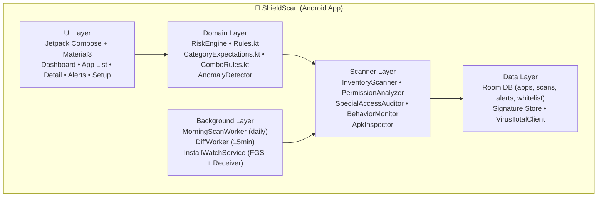

<div align="center">

# 🛡️ ShieldScan

### Advanced On-Device Android Security Auditor
**Inventory • Permission Intelligence • Behavior Monitoring • Install Watch**

[](https://kotlinlang.org)
[](https://developer.android.com)
[](https://developer.android.com/jetpack/compose)
[](LICENSE)
[](#-privacy-first)
[](CONTRIBUTING.md)

**Scan karo. Samjho. Secure raho.**

*Privacy-first, offline-first Android antivirus auditor jo har app ko scan karta hai, batata hai kaun kya kar raha hai, aur nayi threat aate hi alert karta hai.*

[Features](#-features) • [Architecture](#️-architecture) • [Risk Engine](#-risk-engine--scoring-system) • [Installation](#-installation) • [Roadmap](#️-roadmap)

---

**⚠️ Honest Scope:** Koi bhi tool 100% guarantee nahi de sakta. Google Play Protect, Kaspersky bhi nahi. ShieldScan ka goal hai — *maximum visibility + low false positives + clear explanation.*

</div>

---

## 📑 Table of Contents

- [Why ShieldScan?](#-why-shieldscan)
- [Features](#-features)
- [Architecture](#️-architecture)
- [Risk Engine & Scoring System](#-risk-engine--scoring-system)
- [Behavior Monitoring](#️-behavior-monitoring)
- [New App Watch — Dual Layer](#-new-app-watch--dual-layer)
- [APK Deep Inspector](#-apk-deep-inspector)
- [Screenshots](#-screenshots)
- [Installation](#-installation)
- [Setup Wizard](#-setup-wizard)
- [Project Structure](#-project-structure)
- [Tech Stack](#-tech-stack)
- [Permissions Explained](#-permissions-explained)
- [Optional: Threat Intelligence](#-optional-threat-intelligence-vt--malwarebazaar)
- [Privacy First](#-privacy-first)
- [Testing & Validation](#-testing--validation)
- [Limitations You Must Know](#️-limitations-you-must-know)
- [Roadmap](#️-roadmap)
- [Contributing](#-contributing)
- [Security Policy](#-security-policy)
- [FAQ](#-faq)
- [Acknowledgements](#-acknowledgements)
- [License & Disclaimer](#-license--disclaimer)

---

## 💡 Why ShieldScan?

Most “antivirus” apps are just signature scanners. Modern Android malware — **Banking Trojans, RATs, Botnets, Stalkerware** — hides behind:

- Sideloaded APKs with fake system names (`System Update`, `Wifi Service`)
- Abuse of **Accessibility + Device Admin + Overlay**
- Hidden launcher icons
- Night-time beaconing to C2 servers
- Over-permissioned Torch/Calculator apps

ShieldScan doesn't just check hashes. It **audits permissions vs. intent, monitors behavior, detects hidden apps, and watches installs in real-time** — all on-device.

> Android-only. iOS sandboxing blocks third-party app scanning — this is an Android platform limitation, not ours.

---

## ✨ Features

| Module | What It Does | Status |
| :--- | :--- | :--- |
| **📦 Full App Inventory** | Lists *every* installed app: package, version, APK path, size, installer source, install/update time, signing cert SHA-256 | ✅ v0.1 |
| **🔑 Permission Audit** | Requested vs Granted split, with danger level. No more guessing. | ✅ v0.1 |
| **🧠 Permission Necessity Engine** | Category-aware intelligence: *Does a Flashlight need SMS?* | ✅ v0.2 |
| **🚨 Risk Score 0-100** | Weighted scoring + **Combo Rules** for banking trojan / RAT patterns | ✅ v0.2 |
| **👁️ Special Access Audit** | Accessibility, Device Admin, Notification Listener, Overlay, Install-Unknown-Apps | ✅ v0.3 |
| **🫥 Hidden App Detector** | User-installed apps with no launcher icon = red flag | ✅ v0.3 |
| **🌅 Morning Auto-Scan** | Daily 7 AM scan via `WorkManager` with summary notification | ✅ v0.3 |
| **🆕 New App Watch** | Dual-layer instant alert on `PACKAGE_ADDED` | ✅ v0.3 |
| **📊 Behavior Monitor** | Per-app network `NetworkStatsManager` + foreground/background `UsageStatsManager` | 🔄 v0.4 |
| **🔍 Deep APK Inspector** | Components, exported surfaces, embedded URLs/IPs, cert info | ✅ v0.2 |
| **🌐 Hash Reputation** | Optional VirusTotal / MalwareBazaar lookup — **hash only, never APK** | ✅ v0.2 |
| **📈 Reports & Timeline** | Scan history, new installs, score changes | 🔄 v0.4 |
| **🔔 Anomaly Alerts** | Night uploads, ghost apps, dormant-but-dangerous apps | 🔄 v0.4 |

---

## 🏗️ Architecture

No backend. No account. Everything runs on-device.



**Data flow for a scan:**
```
PackageManager → InventoryScanner → PermissionAnalyzer → RiskEngine → Room DB → UI + Notification
                                      ↘ (optional) VirusTotal hash lookup
```

**Tech principles:**
- **Offline-first:** Works without internet. Hash lookups are opt-in.
- **Battery-aware:** `WorkManager` with `RequiresBatteryNotLow`, respects Doze.
- **Fail-safe:** Dual-layer install watch ensures nothing slips.

---

## 🧮 Risk Engine / Scoring System

This is the brain of ShieldScan. Three layers: **Necessity → Weights → Combos**.

### 1. Permission Necessity (Category Intelligence)

Every app category has an expected permission set. Anything outside = `unnecessary`.

```kotlin
val expected = mapOf(
    Category.GAME         to setOf(INTERNET, VIBRATE, WAKE_LOCK),
    Category.PRODUCTIVITY to setOf(INTERNET, READ_EXTERNAL_STORAGE, CAMERA),
    Category.AUDIO        to setOf(INTERNET, RECORD_AUDIO, FOREGROUND_SERVICE),
    Category.VIDEO        to setOf(INTERNET, CAMERA, RECORD_AUDIO),
    Category.MAPS         to setOf(INTERNET, ACCESS_FINE_LOCATION, ACCESS_COARSE_LOCATION),
    Category.SOCIAL       to setOf(INTERNET, CAMERA, RECORD_AUDIO, READ_CONTACTS),
    Category.BANKING      to setOf(INTERNET, USE_BIOMETRIC, CAMERA),
    Category.UTILITY      to setOf(INTERNET), // Torch, Calculator, Wallpaper = minimal
    Category.UNDEFINED    to setOf(INTERNET)
)
```

> Example: `Flashlight - Torch` requesting `READ_SMS + READ_CONTACTS` → **immediately flagged**. Plain English reason: *“Is Flashlight app ko SMS aur Contacts chahiye, jo iska kaam nahi hai.”*

### 2. Weighted Scoring

| Capability / Signal | Weight | Why It Matters |
| :--- | :---: | :--- |
| ♿ Accessibility Service enabled | **+40** | Can read screen, auto-click, steal OTPs |
| 👑 Device Admin active | **+35** | Prevents uninstall, locks device |
| 💬 SMS Read/Send | **+30** | OTP interception, premium SMS fraud |
| 🫥 Hidden launcher icon | **+30** | Classic malware hiding |
| 🔔 Notification Listener | **+25** | Reads OTPs, messages from notifications |
| 🪟 Overlay (Draw over apps) | **+25** | Fake login screens (banking trojan) |
| 📥 Install Unknown Apps | **+25** | Can drop more malware |
| 🎙️ Mic / 📷 Camera / 📍 Location (mismatched) | **+20** each | Spyware pattern |
| 📦 Sideloaded (not from Play Store) | **+20** | Higher risk provenance |
| 👥 Contacts / Call Log | **+15** | Data exfiltration |
| 🕰️ Targets old SDK ≤ 22 | **+10** | Bypasses runtime permissions |

### 3. Combo Rules (Pattern Detection) — The Killer Feature

Single permissions are noisy. *Combinations* catch real malware:

| Pattern | Verdict | Example Malware Family |
| :--- | :--- | :--- |
| `SMS + Accessibility + Overlay` | 🔴 **CRITICAL — Banking Trojan** | Anubis, Cerberus, SharkBot |
| `Accessibility + Device Admin + Hidden Icon` | 🔴 **CRITICAL — RAT / Stalkerware** | SpyNote, mSpy-like |
| `Mic + Location + Hidden + Background Data` | 🟠 **HIGH — Spyware** | Pegasus-style, Spywares |
| `Utility App + Any Dangerous Permission` | 🟠 **HIGH — Suspicious** | Fake Torch, Cleaners |
| `No Launcher + Network + Accessibility` | 🔴 **CRITICAL — Botnet Dropper** | Joker, Harly |

### Verdict Bands

| Score | Level | Action |
| :---: | :--- | :--- |
| **0–30** | 🟢 Safe | Nothing to do |
| **31–60** | 🟡 Review | Check permissions, decide |
| **61–85** | 🟠 Risky | Recommend review / uninstall |
| **86–100** | 🔴 Critical | Immediate action required |

Every score ships with a **human-readable explanation**, not just a number.

---

## 👁️ Behavior Monitoring

Requires user-granted special access (guided onboarding). Uses only official Android APIs:

| Signal | API | What We Detect |
| :--- | :--- | :--- |
| Enabled Accessibility Services | `Settings.Secure.ENABLED_ACCESSIBILITY_SERVICES` | Which apps can read your screen |
| Active Device Admins | `DevicePolicyManager.getActiveAdmins()` | Who can lock/wipe you |
| Notification Listeners | `NotificationManagerCompat.getEnabledListenerPackages()` | Who reads your OTPs |
| Overlay / Install-Unknown | `AppOpsManager.unsafeCheckOpNoThrow()` | Who draws over apps / installs others |
| Per-app Network Usage | `NetworkStatsManager.queryDetailsForUid()` | Who exfils data, how much |
| Foreground/Background | `UsageStatsManager.queryEvents()` | Who runs at 3 AM without you opening it |

### Anomaly Rules

```kotlin
// Night exfiltration
if (app.uploadBytes between 00:00-05:00 > THRESHOLD) -> Alert("Large night upload: ${app.name}")

// Ghost app
if (app.neverOpenedByUser && app.backgroundData > 0) -> Alert("Never opened but uses background data")

// Dormant risk
if (app.lastOpened > 7.daysAgo && app.hasDangerousPerms) -> Alert("Unused for 7 days but holds dangerous permissions")

// Hidden + Network
if (app.isHidden && app.networkActivity > 0) -> Alert("Hidden app with active network")
```

---

## 🔔 New App Watch — Dual Layer

One layer is not reliable on modern Android. We use two:

**Layer 1 — Instant (Foreground Service):**
```kotlin
// Dynamic receiver inside InstallWatchService (manifest receiver is unreliable on Android 12+)
IntentFilter().apply {
    addAction(Intent.ACTION_PACKAGE_ADDED)
    addAction(Intent.ACTION_PACKAGE_REPLACED)
    addAction(Intent.ACTION_PACKAGE_REMOVED)
    addDataScheme("package")
}
```
→ Real-time notification within seconds.

**Layer 2 — Safety Net (WorkManager every 15 min):**
```kotlin
class DiffWorker(ctx: Context, p: WorkerParameters) : CoroutineWorker(ctx, p) {
    override suspend fun doWork(): Result {
        val current = pm.getInstalledPackages(0).map { it.packageName }.toSet()
        val previous = db.snapshotDao().getLastSnapshot()
        val newApps = current - previous
        newApps.forEach { scanAndAlert(it) }
        return Result.success()
    }
}
```
→ Catches anything Doze or force-stop missed.

**Alert looks like:**
```
🚨 Nayi app install hui: “PDF Reader Pro”
Source: Unknown (sideloaded) · Risk: 78/100 🔴
Permissions: SMS, Accessibility, Overlay
[ Details ] [ Uninstall ] [ Mark Safe ]
```

---

## 🔍 APK Deep Inspector

Tap any app → full forensic view:

- **Identity:** APK path, size, SHA-256, signer cert fingerprint, min/target SDK
- **Provenance:** Installer = `com.android.vending` ? Play Store : Sideloaded
- **Components:** Activities / Services / Receivers / Providers — which are **exported** (attack surface)
- **Static Strings:** Embedded URLs, IPs, Telegram tokens, Firebase endpoints (via DEX string scan)
- **Reputation:** Optional VirusTotal lookup

```kotlin
val flags = PackageManager.GET_PERMISSIONS or PackageManager.GET_SIGNING_CERTIFICATES
val pkg = pm.getInstalledPackages(PackageManager.PackageInfoFlags.of(flags.toLong()))

val installer = pm.getInstallSourceInfo(packageName).installingPackageName // null = sideloaded
val sha256 = hashFile(File(info.sourceDir))
val signer = pkg.signingInfo.apkContentsSigners.first().toSha256()
val isHidden = pm.getLaunchIntentForPackage(packageName) == null && !isSystemApp
```

---

## 🖼️ Screenshots

> Placeholders — replace with real captures in `docs/screenshots/`

| Dashboard | App List | App Detail | Alerts |
| :---: | :---: | :---: | :--- |
| Security score + last scan + alerts | Sorted by risk, filters: Risky/Sideloaded/Hidden | Permissions table + behavior timeline | Daily reports + new install timeline |
|  |  |  |  |

---

## 🚀 Installation

### Requirements

| Tool | Version |
| :--- | :--- |
| Android Studio | Koala+ |
| JDK | 17 |
| Android SDK | 34 (min SDK 26 / Android 8.0) |
| Device / Emulator | Android 8.0+ |

### Quick Start

```bash
# 1. Clone
git clone https://github.com/poxsky/antivirus.git
cd antivirus

# 2. Open in Android Studio and let Gradle sync

# 3. Build & install debug
./gradlew assembleDebug
./gradlew installDebug

# Or run tests
./gradlew test
./gradlew connectedAndroidTest
```

### Build Variants

```bash
./gradlew assembleDebug       # Dev build, logging enabled
./gradlew assembleRelease     # Proguard/R8, signed with your keystore
```

---

## 🧙 Setup Wizard

First launch walks you through **3 critical grants** (all optional but recommended):

1. **Usage Access** (`PACKAGE_USAGE_STATS`) → Behavior monitoring. *Settings → Special Access → Usage Access → ShieldScan → Allow*
2. **Notifications** (`POST_NOTIFICATIONS`) → Scan summaries & new-app alerts
3. **Battery Unrestricted** → Reliable morning scans. *Settings → Battery → Unrestricted*

> Without Usage Access, ShieldScan still does inventory + permission + risk scoring. With it, you get the full behavioral layer.

---

## 🗂️ Project Structure

```
app/src/main/java/com/shieldscan/
├── data/               # Room: AppEntity, ScanReport, Alert, Whitelist, DAOs, Repos
│   ├── db/
│   ├── dao/
│   └── repo/
├── scanner/            # Core engines
│   ├── InventoryScanner.kt
│   ├── PermissionAnalyzer.kt
│   ├── SpecialAccessAuditor.kt
│   ├── BehaviorMonitor.kt
│   └── ApkInspector.kt
├── risk/               # Scoring brain
│   ├── RiskEngine.kt
│   ├── Rules.kt
│   ├── CategoryExpectations.kt
│   └── ComboRules.kt
├── workers/            # Background
│   ├── MorningScanWorker.kt    # Daily 7 AM
│   └── DiffWorker.kt           # 15-min safety net
├── service/
│   └── InstallWatchService.kt  # FGS + dynamic receiver
├── net/
│   └── VirusTotalClient.kt     # Hash-only lookup, rate-limited
└── ui/                 # Jetpack Compose
    ├── dashboard/
    ├── applist/
    ├── detail/
    ├── alerts/
    ├── setup/
    └── theme/

docs/
├── screenshots/
└── threat-model.md
```

---

## 🧰 Tech Stack

| Layer | Tech | Why |
| :--- | :--- | :--- |
| **Language** | Kotlin 2.0 | Coroutines, null-safety |
| **UI** | Jetpack Compose + Material3 | Modern, fast |
| **DB** | Room | Offline scan history |
| **Background** | WorkManager, Foreground Service | Reliable scheduling |
| **Network** | OkHttp + Retrofit + Cert Pinning | Hash lookups only |
| **Native** | C++/Rust via NDK (roadmap) | Fast YARA / hash |
| **Analysis** | Androguard, YARA, apkid (backend roadmap) | APK forensics |
| **ML** | LightGBM → TFLite/ONNX (roadmap) | Zero-day detection |
| **Infra** | Optional FastAPI + PostgreSQL + Redis | Future cloud sandbox |

---

## 🔐 Permissions Explained

We request the minimum. Every permission is explained in-app and here:

| Permission / Access | Why | Required? |
| :--- | :--- | :--- |
| `QUERY_ALL_PACKAGES` | Enumerate installed apps | **Yes** — core |
| `PACKAGE_USAGE_STATS` (Usage Access) | Foreground/background, anomaly detection | Recommended |
| `POST_NOTIFICATIONS` | Scan summaries, new-app alerts | Recommended |
| `FOREGROUND_SERVICE` | Live install watcher | Recommended |
| `RECEIVE_BOOT_COMPLETED` | Re-schedule workers after reboot | Recommended |
| `INTERNET` | *Only* for optional hash reputation | Optional |
| Battery Unrestricted | Prevent Doze from killing morning scan | Optional |

> Play Store note: `QUERY_ALL_PACKAGES` is **restricted**. For personal/sideload use it's fine. For Play Store release, you must submit a declaration form justifying broad inventory need.

---

## 🌐 Optional: Threat Intelligence (VT & MalwareBazaar)

Hash lookups are **opt-in, hash-only, rate-limited**. We never upload APKs.

1. Get a free key: [VirusTotal API](https://www.virustotal.com/gui/join-us) (4 req/min free tier)
2. Add to `local.properties` (never commit!):

```properties
VT_API_KEY=your_api_key_here
```

3. ShieldScan queues and respects 429s. Result example: *“5/62 engines flagged this hash”*

Future: MalwareBazaar, AlienVault OTX, Koodous feeds + local YARA.

---

## 🔒 Privacy First

- ✅ **100% on-device analysis.** No account. No backend.
- ✅ **No analytics, no ads, no tracking.**
- ✅ Optional lookups send **only SHA-256 hashes**, never files, names, or personal data.
- ✅ **Consent-first:** Hash lookup is disabled until you add a key and enable it.
- ✅ Compliant in spirit with **India DPDP Act 2023** & **GDPR** (data minimization).

> Your phone's data stays on your phone. Period.

---

## 🧪 Testing & Validation

```bash
./gradlew test                  # Unit tests: RiskEngine, Rules, Combos
./gradlew connectedAndroidTest  # Instrumented: Inventory, Workers
```

**Detection validation (safe, no real malware):**
- Build a harmless test APK that requests `SMS + Accessibility + Overlay` → verify it scores `CRITICAL`
- Use **EICAR** test file for pipeline sanity
- Research datasets: **Drebin, AndroZoo, CIC-AndMal2017, AMD** (isolated emulator only)

> 🚫 **Never run real malware on a personal device.** Use emulator + snapshot + isolated VM.

---

## ⚠️ Limitations You Must Know

1. **Android only.** iOS third-party apps cannot scan other apps (sandbox).
2. **Cannot silently block installs.** Android doesn't allow normal apps to block `PACKAGE_ADDED`. We detect, alert, and offer one-tap uninstall. Hard-blocking needs **Device Owner / MDM** mode (enterprise).
3. **Behavior is inference.** Android hides exact inter-app runtime. We use `UsageStats` + `NetworkStats` — best available without root.
4. **WorkManager is approximate.** Doze can delay the 7 AM scan by minutes. This is normal Android behavior.
5. **False positives exist.** A legit accessibility app (e.g., screen reader) will score high. Use **Mark Safe / Whitelist**. We pre-whitelist top 50 popular apps.
6. **Not a replacement** for OS updates and installing only from trusted sources (Play Store / F-Droid).

---

## 🗺️ Roadmap

| Phase | Timeline | Deliverables |
| :--- | :--- | :--- |
| **Phase 0** | ✅ Done | Architecture + Risk Model design |
| **v0.1** | Weeks 1–3 | App inventory, permission analyzer, risk score, app list UI |
| **v0.2** | Weeks 4–6 | Special access audit, App Detail, APK inspector, VT hash lookup |
| **v0.3** | Weeks 7–9 | Morning auto-scan, dual-layer install watch, notifications |
| **v0.4** | Weeks 10–13 | Behavior monitor, anomaly rules, reports timeline |
| **v0.5** | Weeks 14–16 | Top-50 whitelist, false-positive tuning, Hindi/Hinglish i18n |
| **v1.0** | Q2 | Static APK analysis: YARA rules, manifest + DEX heuristics, exported-surface audit |
| **v1.x** | Q3 | Local `VpnService` DNS shield: C2 / DGA / beaconing detection, blocklists |
| **v2.0** | Q4 | On-device ML (TFLite) trained on Drebin/AndroZoo, zero-day classification |
| Future | — | Optional cloud sandbox (Frida + mitmproxy), Play Store release, AV-TEST benchmark |

---

## 🤝 Contributing

We love contributions — especially **rules, whitelists, translations, and UI polish.**

```bash
# 1. Fork → clone your fork
git clone https://github.com/<your-username>/antivirus.git

# 2. Branch
git checkout -b feature/awesome-rule

# 3. Commit (conventional commits please)
git commit -m "feat(risk): add overlay+accessibility combo for banking trojan"

# 4. Push + PR
git push origin feature/awesome-rule
```

**Good first issues:**
- Add apps to `whitelist.json` (WhatsApp, Maps, etc.)
- Improve `CategoryExpectations.kt` for new categories
- Translations: Hindi, Hinglish, regional
- UI: dark mode, tablet layout

Please follow **Kotlin style** (`ktlint`) and add tests for new rules. See [CONTRIBUTING.md](CONTRIBUTING.md).

---

## 🛡️ Security Policy

Found a vulnerability in **ShieldScan itself**?

- **Do not** open a public issue.
- Email: **security@shieldscan.dev** (or open a GitHub Security Advisory)
- Include: steps to reproduce, impact, suggested fix if any
- We aim to respond within **48 hours**.

See [SECURITY.md](SECURITY.md) for full policy. We follow coordinated disclosure.

---

## ❓ FAQ

**Q: Kya ye sach mein virus hata sakta hai?**
A: Ye *detect* aur *alert* karta hai, aur one-tap uninstall deta hai. Silent removal Android allow nahi karta (bina MDM ke). Par hidden/spy apps ko pakad ke tumhe action lene mein help karta hai.

**Q: Roz subah scan kaise karega? Battery khayega kya?**
A: `WorkManager` se 7 AM ke around ek lightweight scan. Battery low ho to skip. Background FGS sirf install watch ke liye, minimal.

**Q: iPhone pe chalega?**
A: Nahi. iOS kisi bhi third-party app ko dusri apps scan karne nahi deta.

**Q: VirusTotal key zaroori hai?**
A: Bilkul nahi. Hash lookup optional hai. Bina iske bhi permission + behavior + hidden-app detection full kaam karta hai.

**Q: Play Store pe kab ayega?**
A: v1.0 ke baad. `QUERY_ALL_PACKAGES` ke liye Google declaration chahiye — hum prepare kar rahe hain.

---

## 🙏 Acknowledgements

- [Androguard](https://github.com/androguard/androguard) • [YARA](https://virustotal.github.io/yara/) • [APKiD](https://github.com/rednaga/APKiD)
- Threat intel: [MalwareBazaar](https://bazaar.abuse.ch/) • [VirusTotal](https://www.virustotal.com/) • [AlienVault OTX](https://otx.alienvault.com/)
- Datasets: **Drebin, AndroZoo, CIC-AndMal2017, AMD**
- Community testers & translators ❤️

---

## 📜 License & Disclaimer

**License:** MIT — see [LICENSE](LICENSE) for details. Free for personal, educational, and commercial use.

**Disclaimer:** ShieldScan is provided *“as is”* for educational and personal auditing. It does not guarantee detection of all threats. Use only on devices you own or are authorized to assess. Authors are not liable for missed detections or actions taken on scan results.

<div align="center">

### ⭐ If ShieldScan helps you, give it a star — it helps others discover it!

Made with ❤️ for Android users who want to know *kya ho raha hai phone mein*.

[Report Bug](https://github.com/poxsky/antivirus/issues) • [Request Feature](https://github.com/poxsky/antivirus/issues) • [Discussions](https://github.com/poxsky/antivirus/discussions)

</div>
